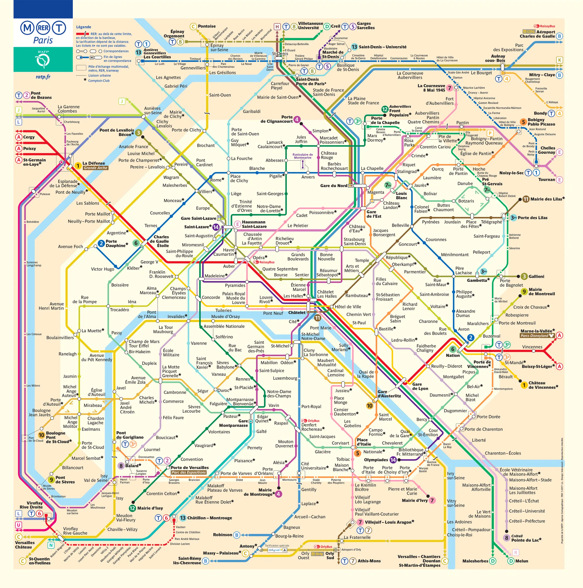

<h2 align = "center"> Descriçao do Problema </h2>

O metrô de Paris deseja oferecer uma nova opção de passe para os turistas poderem visitar os pontos turísticos próximos de cada estação o passe permite que ele desembarque em uma estação depois reembarque nela em direção a outra no entanto, não pode retornar a uma estação já visitada e precisa retornar à estação inicial

OBS: Um problema resolvido com um grafo nao direcionado que implementa o mapa do metrô de Paris modelado como um grafo:

Vértices = estações
Arestas = trechos entre duas estações consecutivas de uma linha 

<h5 align = "center">
  OBSERVAÇOES:   
  O metrô tem ao todo 14 linhas principais e 303 estações  
  Sendo elas presentes no arquivo Estaçoes.json

  [Site com as estaçoes](https://parispass.com/pt/paris-transport/metro-map)
</h5>

---

<h2 align = "center"> Especificações </h2>

O trabalho esta divido em 3 problemas principais que devem ser resolvidos com 3 tipos de metodos:

**(a) Por força bruta:** 
  1. ja dado em sala de aula

**(b) Por branch-and-bound a partir da solução por força-bruta:**

  2. Que elimine ramos da árvore desoluções que se mostrarem improdutivas, através da especificação de um lower/upper bound eficaz. Verificar se é o mesmo que o obtido por força-bruta e comparar (obs: conteudo nao passado ainda) os tempos de processamento das duas soluções.

**(c) Por uma solução aproximada para o problema:**

  3. Não garanta o ótimo, mas seja executada em tempo polinomial no pior caso. Justificar a escolha da heurística

----

Os problemas a serem resolvidos sao:

**(a) Passeio turístico máximo:**
  1. Determinar o número máximo de estações que um turista poderá visitar com um só passe,
  saindo e retornando de uma determinada estação. 

**(b) Guichês de venda de passes:**

  1. Determinar as estações para instalação de guichês para venda de passes, de modo que um
  turista não precise caminhar mais que uma estação para encontrar um guichê. Devem ser
  determinados o número mínimo de guichês a serem instalados e as estações que devem
  recebe-los.

**(c) Períodos de manutenção:**

  3. Determinar o menor número de períodos de manutenção necessários para realizar
  intervenções nas estações, de forma que duas estações diretamente conectadas pela mesma
  linha não sejam submetidas à manutenção simultaneamente.
---

O que deve ser implementado é uma interface que deve ser totalmente gráfica e deverá:

**(a) Ler um arquivo contendo a localização das estações, onde cada linha é da forma “Nome x y”,onde “Nome” é o nome da estação, “x” e “y” são as coordenadas aproximadas das estações, relativas ao canto superior esquerdo da janela e baseada no plano do metrô**

  1. Exemplo:
  Nation 100 150
  République 50 100
  Opéra 50 50

  2. Explicaçao: E necessario que a interfaçe leia um arquivo e posicione as estaçoes e linhas entre elas (verticies e arestas) de acordo com a posiçao dada no arquivo de exemplo, nesse caso seria o Nation: 100 na cordenada x e 150 na cordenada Y, tendo como ponto de incio o canto superior esquerdo da janela, ou seja, as cordenadas (0,0)

**(b) O grupo deverá gerar o arquivo correspondente às linhas segundo o critério N=(soma dos números de matrícula do grupo) mod 5. Apenas as estações que sirvam 2 ou mais linhas, além das estações de início e fim das linhas precisam ser incluídas:**

1. N=0: 1,2,4,6,7,9,10,11,12,14
   N=1: 1,2,3,4,6,9,11,12,13,14
   N=2: 1,2,4,5,6,7,8,9,11,14
   N=3: 1,2,3,4,5,6,8,10,12,13
   N=4: 1,2,4,5,6,7,9,10,12,13

2. N=1: 1,2,3,4,6,9,11,12,13,14 essa e a linha que vamos utilizar

